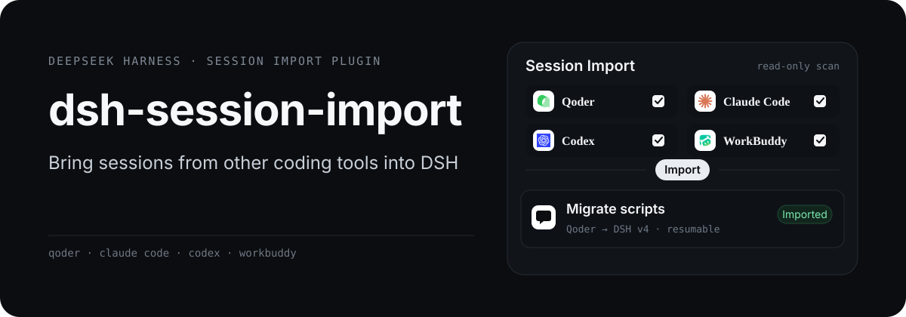
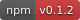
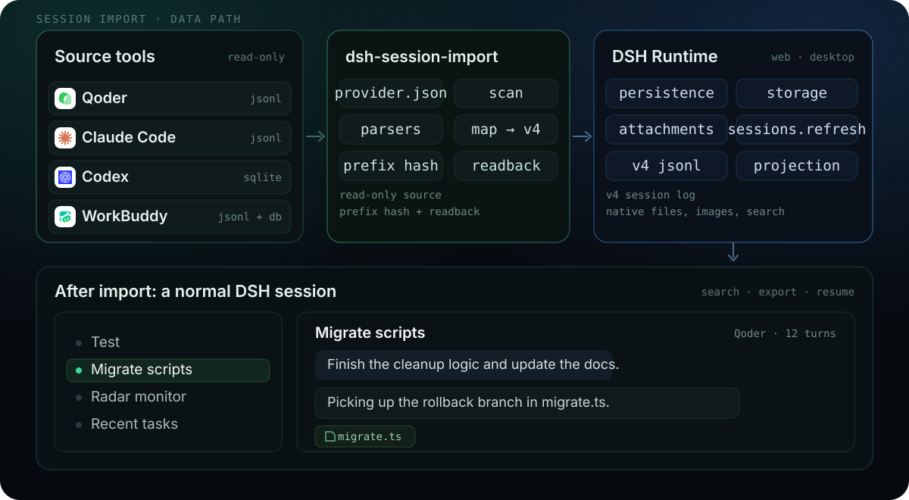
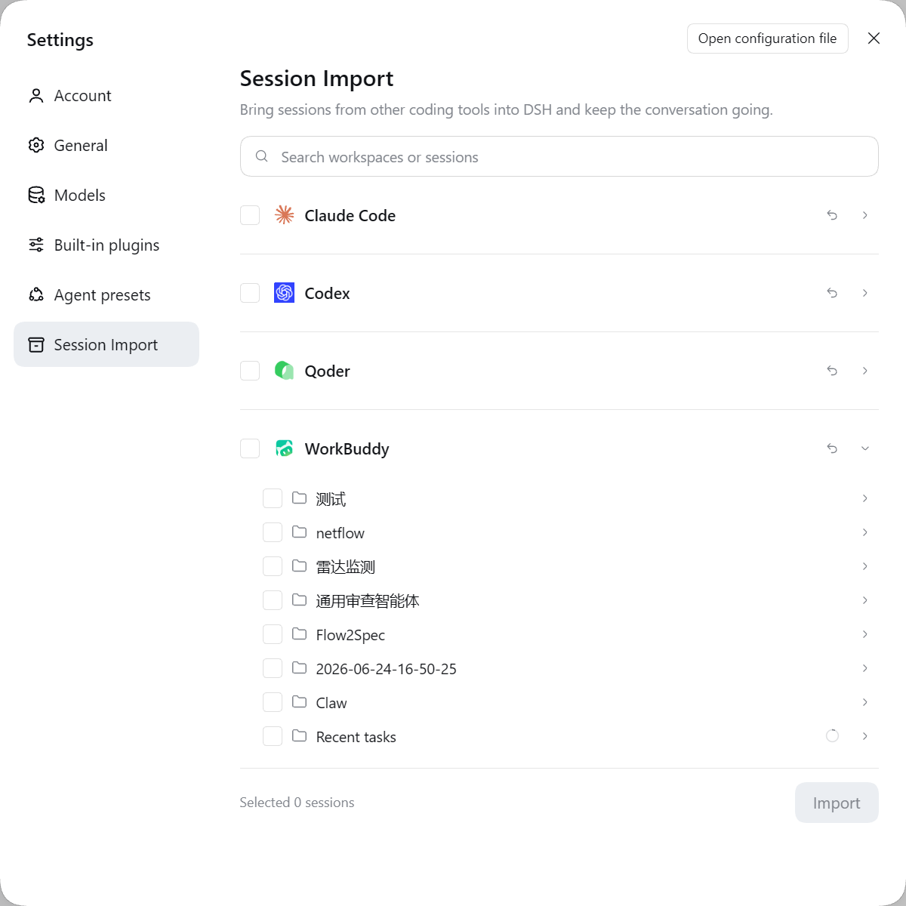

<p align="center">
  
</p>

<div align="center" class="text-center">
  <a href="https://github.com/double-coding-lab/dsh-session-import/blob/main/README.md">简体中文</a> · <strong>English</strong>
</div>

<br>

<div align="center" class="text-center">
  <a href="https://www.npmjs.com/package/@double-coding/dsh-session-import"></a>
  <a href="https://github.com/double-coding-lab/dsh-session-import"></a>
  <a href="https://github.com/double-coding-lab/dsh-session-import/blob/main/LICENSE"></a>
  
</div>

When you switch tools, the model is not the hard part — the history is. dsh-session-import brings Qoder, Claude Code, Codex and WorkBuddy sessions into DeepSeekRuntime as regular DSH sessions: searchable, exportable, and ready to continue.

## Architecture

<p align="center">
  
</p>

- Source directories are read-only: the plugin never writes, renames, or follows a symlink outside its allowed roots.
- Parsers are split by format family, so a tool in a known family only needs a `provider.json`: Claude-style jsonl, the Codex desktop SQLite databases, and WorkBuddy jsonl plus its index database.
- Writes go through DSH's `sessionPersistence`: create, append, then read back. Sessions land in the sidebar under the workspace or project name they came from.

## UI and demo



Settings → **Session Import**. Sessions are grouped by app → workspace, and the search box finds a specific conversation. Once you select sessions, the footer shows the count and the Import button stays in place.

## What it does

- **Imports only the part that still fits**: Claude-family sessions start after the last compaction point instead of replaying the whole history. A single text block over 262144 characters keeps its head and tail around a truncation marker, so a huge tool result cannot blow up the context.
- **Re-importing never forks copies**: a source fingerprint plus an event-prefix hash decides what to do. A longer source appends only the new events; a shifted prefix stops with an error instead of stitching two histories together.
- **A failed import leaves nothing behind**: every write is read back through `sessionPersistence` before the session is reported as done.
- **Interrupted sessions can be recovered**: Qoder only writes `active-leaf` on a clean exit; without it, the parser takes the newest leaf and drops abandoned branches.
- **Files, images and titles come along**: local file links become native file chips, user images are copied into attachments, and a custom title from the source tool wins over a generated one.
- **Scratch sessions land in Recent tasks**: a missing cwd, scratch directories and WorkBuddy quick tasks are grouped there and imported into DSH's ungrouped list, without creating empty workspaces.
- **Background automations keep the latest run**: WorkBuddy's background runs are merged by `automation_runs`, matching its own sidebar; older imported runs stay retractable.
- **Follows the DSH language switch**: panel copy switches between Chinese and English immediately.

## Supported tools

| Tool | Read from | Notes |
| --- | --- | --- |
| Qoder | `~/.qoder/projects/*/*.jsonl` | Uses `workspace-directories` as the workspace; understands `file://` links |
| Claude Code | `~/.claude/projects/*/*.jsonl` | Titles from `aiTitle` / `customTitle`; skips `claude-sandbox-status-*` |
| Codex | `~/.codex/state_5.sqlite`, `thread_history_1.sqlite`, `.codex-global-state.json` | Grouped by desktop project, completed turns only; subagent threads and executor prompts are excluded |
| WorkBuddy | `~/.workbuddy/projects/*/*.jsonl` + `workbuddy.db` | Titles, spaces and quick-task flags come from the index database; background automations collapse to the latest run |

Temporary single sessions (missing cwd, Qoder / Codex scratch directories, WorkBuddy quick tasks without a project) all appear under Recent tasks. Projects and workspaces keep the grouping they had in the source tool, so a single session never turns into an empty workspace.

## Install

Requires Node `^22.19.0 || >=24.0.0` and DeepSeekRuntime `0.2.x` (tested on 0.2.1).

### DSH Desktop

Open Settings → Plugins, or Add plugin on the plugins page, and enter `@double-coding/dsh-session-import` (a GitHub URL or a local folder also works). Follow the prompt to install.

The Desktop profile is managed by the app. A terminal install into `web` will not show up there. Quit and relaunch Desktop after installing.

### dsh web

```bash
dsh plugin --profile web add @double-coding/dsh-session-import
```

`web` is the default web profile. If you use a custom profile, replace `web` with the name the host actually loads:

```bash
dsh plugin --profile <profile> add @double-coding/dsh-session-import
```

Stop the running `dsh web` process before starting it again. A page refresh does not load the new backend plugin.

<details>
<summary>Install from source</summary>

```bash
npm install --legacy-peer-deps
npm run check
dsh plugin --profile <profile> add link:.
```

Replace `<profile>` the same way, then restart as above.

</details>

### Open the panel

After the restart, go to **Settings → Session Import**. The first open scans every supported source tool on this machine. Nothing is uploaded.

## Files and attachments

- Local file links in a source session are kept as native DSH file chips: click one to preview it in the right panel, with no browser protocol involved.
- The rules live in `provider.json` under `fileLinks` and are pure data; Qoder reads `[name](file:///D:/…)` links, while other tools can declare absolute or workspace-relative paths.
- During import the link becomes inline code (same-name files keep their full path) and is written to that turn's `deliverables/presented`, so DSH's own file-mention parser handles the click.
- DSH only resolves file mentions on the final assistant message of a turn, so links in intermediate messages stay plain text.
- User files become native `@path` references; images are copied into DSH attachments, preferring the source tool's local copy and using a signed URL only as a fallback.

## Limits

- Incremental appends require the source window to keep its prefix. If the window moves forward, the panel asks you to retract and import again.
- WorkBuddy project names exist only in its cloud. Add local aliases in `~/.dsh/session-import/workbuddy-projects.json` (`{"<projectId>": "Name"}`); otherwise the workspace shows as Project. Cloud-only tasks with no local transcript never appear.
- WorkBuddy shows only the latest run per background automation, matching its own sidebar.
- Source tools rewrite titles and last-prompt metadata in place. "New content" is decided by file size, head hash and the last real message time, so metadata-only rewrites do not trigger it.
- Reasoning is dropped by default: Claude and Codex thinking blocks are signed or server-encrypted and cannot be replayed in another host.
- Sessions imported by an earlier build, back when file links were plain text, need to be retracted and imported again. Re-importing an unchanged source is skipped, so old logs are not rewritten automatically.
- Retract deletes the `import-` session directories created by this plugin. DSH has no delete-session API, so nothing else is touched.
- Sessions only. Memory, skills, MCP servers, settings and hooks are not migrated: memory has no DSH consumer, and skills and MCP already have dedicated plugins.

## Development

```bash
npm run check   # builds host + client and runs the structure, idempotency, incremental and provider suites
```

Client changes require a `dsh web` restart. DSH snapshots the client bundle with a `rev` at startup and keeps serving that snapshot; a new `dist/client.js` on disk is invisible after a page refresh.

To add a tool, start with `providers/<id>/provider.json`; a new parser is only needed for a new format family. Before changing the mapper, read the DSH v4 contract in the [design doc](https://github.com/double-coding-lab/dsh-session-import/blob/main/docs/技术方案.md): `isSeeded`, message `id` / `source`, the `tool-call` broadcast, and `step` resetting every turn. Getting any of these wrong marks the log as corrupt.

## License

[MIT](https://github.com/double-coding-lab/dsh-session-import/blob/main/LICENSE)
