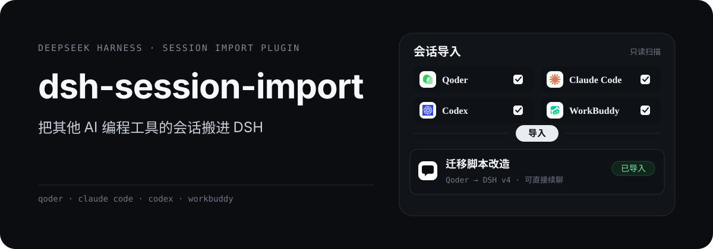
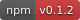
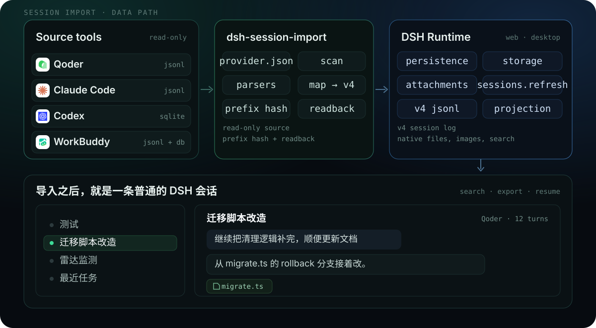
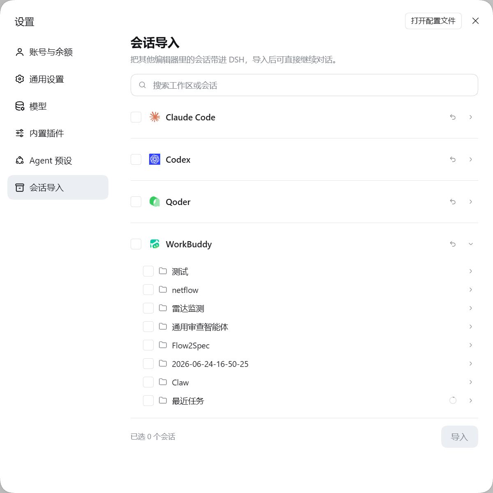

<p align="center">
  
</p>

<div align="center" class="text-center">
  <strong>简体中文</strong> · <a href="https://github.com/double-coding-lab/dsh-session-import/blob/main/README.en.md">English</a>
</div>

<br>

<div align="center" class="text-center">
  <a href="https://www.npmjs.com/package/@double-coding/dsh-session-import"></a>
  <a href="https://github.com/double-coding-lab/dsh-session-import"></a>
  <a href="https://github.com/double-coding-lab/dsh-session-import/blob/main/LICENSE"></a>
  
</div>

换工具的时候，模型不是问题，历史才是。dsh-session-import 把 Qoder、Claude Code、Codex、WorkBuddy 的会话导入 DeepSeekRuntime，生成一条正常的 DSH 会话：能搜索、能导出，也能直接接着聊。

## 架构

<p align="center">
  
</p>

- 源目录只读：插件不会写入、重命名，也不会跟随符号链接逃逸到白名单根之外。
- 解析器按格式家族分工，同一个家族的工具只差一份 `provider.json`：Claude 系 jsonl、Codex 桌面 SQLite、WorkBuddy jsonl + 索引库。
- 写入走 DSH 的 `sessionPersistence`：创建、追加、回读校验；会话按源工具的工作区或项目名挂到侧栏对应位置。

## 界面与演示



设置 → **会话导入**。按应用 → 工作区分组，搜索框可以定位到具体会话；勾选后底部固定显示已选数量，点「导入」开始。

## 主要能力

- **只搬还能续聊的那一段**：Claude 系的会话从最后一次压缩点之后开始，不把整个历史重放一遍；单个文本块超过 262144 字符时保留头尾并插入截断标记，避免巨型工具结果撑爆上下文。
- **重复导入不会多出副本**：按源文件指纹和事件前缀哈希判断。源变长了只追加新增事件；前缀对不上直接报错，不会把两段历史硬缝在一起。
- **失败不会留下半截会话**：写完立刻用 `sessionPersistence` 回读校验，读不回就按失败处理。
- **中断的源会话也能恢复**：Qoder 正常退出才写 `active-leaf`；没有这个标记时，解析器取最新叶子并排除被放弃的分支。
- **文件、图片、标题一起搬**：本地文件链接变成 DSH 原生文件 chip；用户图片转存为附件；源工具里的自定义标题优先。
- **临时会话统一进「最近任务」**：没有 cwd、scratch 目录、WorkBuddy 快速任务都归到这里，导入后进入 DSH「未分组」，不会创建空工作区。
- **后台自动化只留最新一条**：WorkBuddy 的后台自动化按 `automation_runs` 归并，和它自己的侧栏一致；已导入的旧运行仍保留撤回入口。
- **跟随 DSH 中英文切换**：面板文案即时切换，不用重启。

## 支持的工具

| 工具 | 读取位置 | 说明 |
| --- | --- | --- |
| Qoder | `~/.qoder/projects/*/*.jsonl` | 从 `workspace-directories` 取工作区；识别 `file://` 文件链接 |
| Claude Code | `~/.claude/projects/*/*.jsonl` | 标题取 `aiTitle` / `customTitle`；跳过 `claude-sandbox-status-*` |
| Codex | `~/.codex/state_5.sqlite`、`thread_history_1.sqlite`、`.codex-global-state.json` | 按桌面项目分组，只导入已完成回合；排除子代理线程和执行器机器提示 |
| WorkBuddy | `~/.workbuddy/projects/*/*.jsonl` + `workbuddy.db` | 标题、空间、快速任务标记来自索引库；后台自动化按运行归并 |

临时单会话（cwd 缺失、Qoder / Codex scratch 目录、WorkBuddy 无项目的快速任务）统一显示在「最近任务」。项目和工作区沿用源工具的分组；临时单会话不会创建新的工作区。

## 安装

要求：Node `^22.19.0 || >=24.0.0`，DeepSeekRuntime `0.2.x`（在 0.2.1 上验证）。

### DSH Desktop

打开「设置 → 插件」或插件页的「添加插件」，输入包名 `@double-coding/dsh-session-import`（也支持 GitHub 仓库地址或本地目录），按提示安装。

Desktop 的 profile 由应用管理。从终端装到 `web` 等其它 profile 不会出现在 Desktop 里；安装完成后完全退出并重新启动 Desktop。

### dsh web

```bash
dsh plugin --profile web add @double-coding/dsh-session-import
```

`web` 是默认的 Web profile。如果你自定义过 profile，把 `web` 换成宿主实际加载的名称：

```bash
dsh plugin --profile <profile> add @double-coding/dsh-session-import
```

装完先停掉原来的 `dsh web` 进程再启动；只刷新网页不会加载后端插件。

<details>
<summary>从源码安装</summary>

```bash
npm install --legacy-peer-deps
npm run check
dsh plugin --profile <profile> add link:.
```

`<profile>` 同样换成实际 profile；装完按上面的方式重启。

</details>

### 打开面板

重启后进入「设置 → 会话导入」。首次打开会扫描本机所有已支持的源工具目录，不会上传任何数据。

## 文件与附件

- 源会话里指向本地文件的链接会按 provider 规则保留成 DSH 原生文件 chip：点击在右侧栏预览，不依赖浏览器协议。
- 规则写在 `provider.json` 的 `fileLinks` 里，是纯数据；Qoder 识别 `[文件名](file:///D:/…)`，其他工具可以声明绝对路径或工作区相对路径。
- 导入时链接会改成 inline code（同名文件用完整路径区分），同时写入该轮的 `deliverables/presented`，由 DSH 自带的文件提及解析器接管点击。
- DSH 只在每轮收尾的 assistant 消息上提供文件提及解析，所以轮中过程消息里的链接保持普通文本。
- 用户消息里的文件写成原生 `@路径` 引用；图片转存为 DSH 附件，优先使用源工具本地副本，签名 URL 只作兜底。

## 已知限制

- 增量追加要求源窗口前缀未变；源窗口前移后会提示先撤回再导。
- WorkBuddy 的项目名只存在云端。本地可以在 `~/.dsh/session-import/workbuddy-projects.json` 写 `{"<projectId>": "名称"}` 补别名，没配时显示「项目」。项目页里没有本地转录的纯云端任务不会出现在面板。
- WorkBuddy 后台自动化的历史运行只显示最新一条；这是按 `automation_runs` 归并的结果，和 WorkBuddy 侧栏一致。
- 源工具会原地重写标题、last-prompt 等元数据。「有新增」以文件大小、首行哈希和最后一条真实消息时间为准，元数据变化不会误报。
- 推理内容默认丢弃：Claude 系和 Codex 的 thinking 带签名或服务端加密，换宿主后无法重放。
- 早前导入、文件链接还是纯文本的会话，需要「撤回」后重新导入；源文件没变时重复导入会直接跳过，不会自动改写旧日志。
- 撤回是删除本插件创建的 `import-` 前缀会话目录。DSH 没有删除会话的 API，所以只动这些目录，不碰其它会话。
- 只做会话。记忆、技能、MCP、settings、hooks 不迁移：记忆没有对应的 DSH 消费方，技能和 MCP 已有专门的插件。

## 开发

```bash
npm run check   # 构建宿主 + 客户端，跑结构、幂等、增量、provider 等自检
```

客户端改动必须重启 `dsh web`。DSH 启动时会把客户端产物打成带 `rev` 的快照，之后一直发那份；磁盘上的 `dist/client.js` 换了，刷新页面看不到。

新增一个工具的支持，先改 `providers/<id>/provider.json`；只有出现全新格式家族时才需要写解析器。改 mapper 之前先读 [技术方案](https://github.com/double-coding-lab/dsh-session-import/blob/main/docs/技术方案.md) 里的 DSH v4 契约：`isSeeded`、消息 `id`/`source`、`tool-call` 广播、`step` 每轮重置，这几处写错会被判日志损坏。

## License

[MIT](https://github.com/double-coding-lab/dsh-session-import/blob/main/LICENSE)
